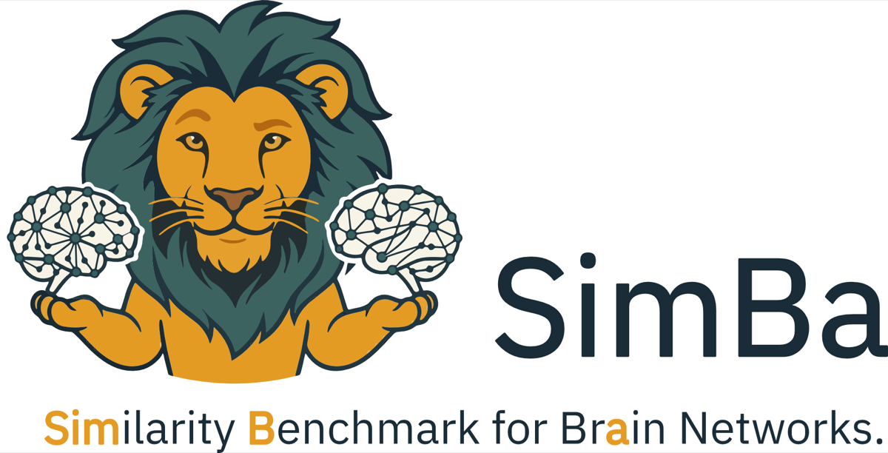

<p align="center">
  
</p>

# SimBa - Similarity Benchmark for Brain Networks

Code and data for *How Similar Are Two Brains? A Comprehensive Benchmark of
Brain Network Similarity Measures* by Adrian Dendorfer, Andrea Luppi, Francesco
Poli, Alexa Mousley, Duncan Astle and Kayson Fakhar.

The paper benchmarks 16 network distance measures for comparing generative
network model (GNM) output with an empirical human connectome, on five
criteria: agreement, biological plausibility, computational efficiency,
sensitivity and robustness, and accuracy. This package ships the 16 measures,
all 25,000 generated networks, and `evaluate()`, which scores a new measure on
the same five criteria and ranks it against the 16.

**Tutorial:** [`tutorial.ipynb`](tutorial.ipynb) walks through both uses below.
**Documentation:** https://ad045.github.io/simba/

```bash
pip install git+https://github.com/ad045/simba
```

## A. Compare two networks

```python
import simba_networks as sb

networks, meta = sb.load_networks()       # (25000, 100, 100), with eta, gamma per network
A, B = networks[0].astype(float), networks[1].astype(float)

sb.MEASURES["delta_con"](A, B)                         # one measure
{name: f(A, B) for name, f in sb.MEASURES.items()}     # all 16
```

A network is a binary, symmetric `(N, N)` array without self-loops. Five
measures are similarities (higher = more alike, listed in `sb.SIMILARITIES`);
the other eleven are distances. `sb.NAMES` gives the name used in the paper.
Values depend on network size and density, so compare networks on the same
parcellation.

## B. Score your own measure against all 16

```python
import numpy as np
import simba_networks as sb

def degree_l1(A, B):
    """Lower = more alike. A: generated network, B: reference (100 x 100, binary)."""
    return float(np.abs(A.sum(0) - B.sum(0)).sum())

report = sb.evaluate(degree_l1, criteria=["accuracy"])   # needs no empirical data
report = sb.evaluate(degree_l1)                           # all five criteria
report.table    # every read-out, your measure next to the 16, and your rank
```

Pass `similarity=True` if higher values of your measure mean more alike.

Accuracy (parameter recovery) compares generated networks with each other and
runs anywhere. The other four criteria compare against the empirical HCP
consensus connectome, which we may not redistribute. Save your copy as
`~/simba_networks_data/reference/consensus.npy` or pass `reference=`
([details](https://ad045.github.io/simba/reference/)).

## Data

The 25,000 networks are bit-packed into `data/networks/morphospace.npz`
(16 MB). The whole bundle in `data/` is about 30 MB: the networks, the
recovery networks, and the published value of every measure on every network.
A pip install has no `data/`, so it downloads the same bundle once into
`~/simba_networks_data`. Layout: [`data/README.md`](data/README.md).

## Repository layout

```
simba_networks/   the 16 measures, data access, evaluate()
data/             25,000 generated networks, recovery networks, result tables
tutorial.ipynb    parts A and B above, step by step
tests/            checks that every measure reproduces the published values
docs/             documentation site (mkdocs)
```

The research pipeline behind the paper (GNM generation, every analysis and
figure) is on the [`main` branch](https://github.com/ad045/simba/tree/main).

## Development

```bash
pip install -e ".[test,docs]"
pytest
```

## Citing

Dendorfer, A., Luppi, A., Poli, F., Mousley, A., Astle, D. and Fakhar, K.
*How Similar Are Two Brains? A Comprehensive Benchmark of Brain Network
Similarity Measures*. Machine-readable metadata: [`CITATION.cff`](CITATION.cff).

## License

MIT. Several measures come from [netrd](https://github.com/netsiphd/netrd) and the
network mutual information from [network-MI](https://github.com/hfelippe/network-MI).
